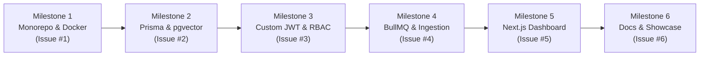

# DocuMind AI — Multi-Tenant SaaS Platform
## Implementation Plan & GitHub Activity Roadmap

> **Workflow Rule:** 1 Milestone = 1 GitHub Issue = 1 Feature Branch = 1 Pull Request.  
> All commits follow [Conventional Commits](https://www.conventionalcommits.org/en/v1.0.0/) (`feat`, `fix`, `chore`, `docs`, `refactor`).

---



---

### Milestone 1: Monorepo Foundation & Docker Infrastructure

* **Issue #1:** `[SETUP] Scaffold Turborepo Monorepo and Docker Services`
* **Branch:** `feat/issue-1-monorepo-docker-setup`
* **Target PR Title:** `feat(infra): scaffold turborepo monorepo with docker compose`

#### Scope & Deliverables
- [x] Initialize Turborepo with npm workspaces.
- [x] Setup `apps/api` (NestJS 10.x with TypeScript, config module, and CORS).
- [x] Setup `apps/web` (Next.js 15 App Router with Tailwind CSS).
- [x] Setup `packages/types` (shared TypeScript interfaces and DTO definitions).
- [x] Setup `packages/config` (shared ESLint and TypeScript configs).
- [x] Create `docker-compose.yml` defining:
  - `postgres` (with `pgvector/pgvector:pg16` image)
  - `redis` (`redis:7-alpine` for BullMQ queues)
- [x] Add `.env.example` with local defaults.

#### Key Commits for this Branch
```bash
git commit -m "chore: initialize turborepo workspace with apps and packages"
git commit -m "feat(infra): add docker-compose with postgres pgvector and redis"
git commit -m "chore(config): configure shared typescript and eslint packages"
```

---

### Milestone 2: Multi-Tenant Database Modeling & Vector Extension (Prisma)

* **Issue #2:** `[DB] Multi-Tenant Prisma Schema with pgvector and Seeding`
* **Branch:** `feat/issue-2-prisma-multitenant-schema`
* **Target PR Title:** `feat(database): configure prisma schema with rbac and pgvector`

#### Scope & Deliverables
- [ ] Configure `packages/database` with Prisma Client.
- [ ] Enable `pgvector` extension via Prisma initial migration.
- [ ] Model core entities:
  - `Tenant`: Multi-tenant isolation boundary (`id`, `name`, `slug`, `plan`, `createdAt`).
  - `User`: Global credentials (`id`, `email`, `passwordHash`, `name`).
  - `Membership`: Tenant-user junction with RBAC (`id`, `userId`, `tenantId`, `role`: `OWNER | ADMIN | MEMBER | VIEWER`).
  - `RefreshToken`: Hashed token store for session rotation (`id`, `tokenHash`, `userId`, `expiresAt`, `revokedAt`).
  - `Document`: Metadata for uploaded PDFs (`id`, `tenantId`, `title`, `fileKey`, `fileSize`, `status`: `PENDING | PROCESSING | READY | FAILED`).
  - `DocumentChunk`: Text chunks and vector embeddings (`id`, `documentId`, `tenantId`, `content`, `pageNumber`, `embedding` vector(1536)).
- [ ] Create a comprehensive `prisma/seed.ts` script (seeds 2 test tenants, 4 users across different roles, sample documents).

#### Key Commits for this Branch
```bash
git commit -m "feat(database): define multi-tenant schema with users, memberships, and tokens"
git commit -m "feat(database): add pgvector extension and document chunk models"
git commit -m "feat(database): implement seed script for test organizations and users"
```

---

### Milestone 3: Custom JWT Auth Engine & Multi-Tenant RBAC (NestJS)

* **Issue #3:** `[AUTH] Custom JWT Authentication, Token Rotation & RBAC Guards`
* **Branch:** `feat/issue-3-custom-jwt-rbac-auth`
* **Target PR Title:** `feat(auth): implement custom jwt with refresh rotation and tenant guards`

#### Scope & Deliverables
- [ ] Auth Module in NestJS:
  - Register (`/api/v1/auth/register`) — creates User and default Personal Tenant.
  - Login (`/api/v1/auth/login`) — returns short-lived Access Token (15m) + secure Refresh Token (7d).
  - Refresh (`/api/v1/auth/refresh`) — implements Refresh Token Rotation (invalidates used refresh tokens).
  - Logout (`/api/v1/auth/logout`) — revokes refresh tokens.
- [ ] Tenant & RBAC Architecture:
  - `JwtAuthGuard`: Validates access token and attaches user payload.
  - `TenantGuard`: Extracts `x-tenant-id` header (or subdomain) and verifies user membership & role.
  - Decorators: `@CurrentUser()`, `@CurrentTenant()`, `@Roles(Role.ADMIN)`.
- [ ] Swagger / OpenAPI setup on `/api/docs`.

#### Key Commits for this Branch
```bash
git commit -m "feat(auth): implement password hashing, jwt sign, and refresh token rotation"
git commit -m "feat(auth): add tenant context extraction and rbac guard decorators"
git commit -m "feat(auth): configure openapi swagger documentation for auth routes"
```

---

### Milestone 4: Async Document Ingestion & Vector Pipeline (BullMQ + pgvector)

* **Issue #4:** `[AI] BullMQ Ingestion Queue, Semantic Chunking & Vector Search`
* **Branch:** `feat/issue-4-document-vector-pipeline`
* **Target PR Title:** `feat(ai): add bullmq ingestion worker and vector similarity search`

#### Scope & Deliverables
- [ ] File Upload Endpoint:
  - `POST /api/v1/documents/upload` (accepts PDF/TXT, enforces tenant isolation, saves to local/S3 mock storage).
- [ ] BullMQ Async Worker (`DocumentProcessor`):
  - Extracts text from document (`pdf-parse`).
  - Semantic sliding-window chunking (500 tokens with 50-token overlap).
  - Generates embeddings (pluggable OpenAI / Mock embedding service for local dev).
  - Inserts chunks into `DocumentChunk` with raw SQL pgvector insertion.
  - Updates `Document.status` to `READY`.
- [ ] Vector Search Service:
  - `POST /api/v1/documents/query` — runs cosine similarity search (`<=>` operator in pgvector) strictly scoped to `tenant_id`.

#### Key Commits for this Branch
```bash
git commit -m "feat(queue): configure bullmq queue and redis connection in nestjs"
git commit -m "feat(ai): implement text extraction and semantic chunking service"
git commit -m "feat(ai): implement pgvector cosine similarity search with tenant scoping"
```

---

### Milestone 5: Next.js Frontend Dashboard & Streaming Chat UI

* **Issue #5:** `[UI] Next.js Dashboard, Tenant Switcher & Streaming Chat UI`
* **Branch:** `feat/issue-5-frontend-dashboard-chat`
* **Target PR Title:** `feat(web): build tenant dashboard and streaming rag chat ui`

#### Scope & Deliverables
- [ ] Custom Auth Context / Provider:
  - Token storage (HTTP-only or secure memory + refresh interceptor).
  - Login & Register views with validation.
- [ ] Multi-Tenant Shell:
  - Organization/Tenant switcher dropdown.
  - Role badge display (`Owner`, `Admin`, `Member`).
- [ ] Document Management:
  - Drag-and-drop document upload with real-time status pill (`Processing`, `Ready`).
- [ ] RAG Chat Assistant:
  - Chat interface with Server-Sent Events (SSE) streaming.
  - Source citations drawer showing which document chunks informed the AI answer.

#### Key Commits for this Branch
```bash
git commit -m "feat(web): add custom jwt auth provider and authentication screens"
git commit -m "feat(web): build tenant switcher and document upload management table"
git commit -m "feat(web): implement streaming ai chat interface with source citations"
```

---

### Milestone 6: Health Checks, Observability & Showcase Documentation

* **Issue #6:** `[DOCS] System Health Monitoring, Seed Data & Showcase README`
* **Branch:** `feat/issue-6-health-checks-readme`
* **Target PR Title:** `docs: add production-grade readme with system architecture`

#### Scope & Deliverables
- [ ] Health check module (`@nestjs/terminus`) on `/api/v1/health` (pings Postgres, Redis, Vector extension).
- [ ] One-command quickstart script: `npm run setup` (installs deps, spins up Docker, runs migrations, seeds data).
- [ ] High-Impact GitHub `README.md`:
  - Architecture diagram (Mermaid).
  - Badges (NestJS, Next.js, Prisma, PostgreSQL, Docker, BullMQ).
  - Security model breakdown (Multi-tenant RLS + JWT Rotation).
  - API documentation & curl walkthrough.

#### Key Commits for this Branch
```bash
git commit -m "feat(api): add terminus health checks for postgres and redis"
git commit -m "chore: add root setup script for automated onboarding"
git commit -m "docs: add comprehensive readme with architecture diagrams and api reference"
```
